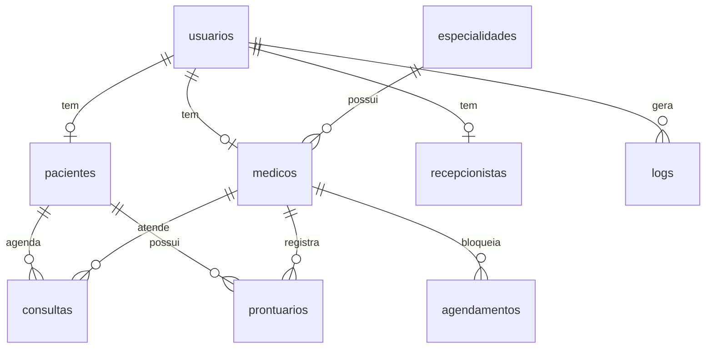

# Vívere SGC — Sistema de Gestão Clínica

Plataforma web para gestão administrativa e clínica da **Clínica Vívere**: agendamento de consultas, agenda médica, prontuário eletrônico e relatórios, com três perfis de acesso (**Paciente**, **Médico** e **Recepcionista**). Trabalho acadêmico — Análise e Desenvolvimento de Sistemas / Engenharia de Software.

> A especificação completa está em [`docs/Vivere_SGC_Documento_de_Projeto.docx`](docs/Vivere_SGC_Documento_de_Projeto.docx). O protótipo navegável original (dados fictícios, sem servidor) está em [`simulador/index.html`](simulador/index.html).

## Tecnologias
PHP 8 (arquitetura **MVC**, PDO) · MySQL 8 · Apache · HTML5/CSS3 (identidade visual do simulador) · Docker · GitHub Actions.

## Estrutura
```
public/          index.php (front controller), assets/css
app/Core/        Database (PDO), Auth (sessão/perfis), Log + Notifier
app/Models/      Usuario, Paciente, Medico, Consulta, Prontuario, Relatorio
app/Controllers/ Auth, Paciente, Medico, Recepcao (+ trait Booking)
views/           templates por perfil (auth, paciente, medico, recepcao, partials)
database/        schema.sql (DDL) · seed.php (dados demonstrativos)
tests/           smoke.sh — teste ponta a ponta (23 verificações)
docker/ + Dockerfile + docker-compose.yml
```

## Como rodar

### Opção 1 — Docker (recomendado)
```bash
git clone <URL-DO-REPOSITORIO> && cd vivere-sgc
docker compose up --build
```
Acesse **http://localhost:8080**. O banco é criado a partir de `database/schema.sql` e populado com dados demonstrativos (`SEED_DEMO=1`).

### Opção 2 — XAMPP / servidor PHP + MySQL
1. PHP 8.1+ com extensões `pdo_mysql` e `mbstring`; MySQL 8 (ou MariaDB 10.6+).
2. Importe `database/schema.sql` (cria o banco `vivere_sgc`).
3. `cp .env.example .env` e ajuste usuário/senha do banco.
4. `php database/seed.php` (opcional, dados demo).
5. Aponte o DocumentRoot do Apache para `public/` — ou, para teste rápido: `php -S localhost:8000 -t public public/index.php`.

## Logins de demonstração (senha: `vivere123`)
| Perfil | E-mail |
|---|---|
| Paciente | `ana.souza@email.com` |
| Médico | `rafael@vivere.demo` |
| Recepcionista | `carla@vivere.demo` |

> **Em produção, não execute o seed** (`SEED_DEMO=0`) e cadastre usuários reais com senhas próprias.

## Requisitos atendidos
| Área | Implementado |
|---|---|
| Paciente (RF01–RF12) | cadastro com validação de CPF/e-mail/telefone, login/logout, recuperação de senha por e-mail, horários por especialidade/médico, agendar/remarcar/cancelar, histórico, atualização de dados, notificações |
| Médico (RF13–RF21) | dashboard, agenda por dia, lista de pacientes, prontuário e evolução clínica, bloqueio de horários, status da consulta |
| Recepção (RF22–RF28, RF32) | cadastro de pacientes/médicos/especialidades, agendamento em nome do paciente, agenda geral, busca por nome/CPF/telefone, inativação de usuários, relatórios com exportação CSV |
| Transversais | conflito de agenda impedido em transação (RF30), log de auditoria (RF29), senhas com `password_hash` (RF05/RNF11) |
| Segurança (RNF) | CSRF em todo POST, SQL preparado (PDO), escape de saída contra XSS, sessão com expiração de 30 min, bloqueio após 5 logins falhos, cookies HttpOnly/SameSite, cabeçalhos de segurança |

**Fora do que está implementado nesta versão:** upload de documentos/exames no prontuário (RF18), exportação de relatórios em PDF (só CSV) e agenda semanal/mensal (a agenda é por dia). HTTPS (RNF01/RNF19) deve ser fornecido pelo servidor/proxy de hospedagem; backups (RNF05) via `mysqldump` agendado.

## Modelo de dados


## Testes
```bash
bash tests/smoke.sh   # requer PHP 8 com pdo_sqlite e mbstring
```
O teste sobe o servidor embutido com SQLite, percorre login, agendamento, conflito de horário, prontuário, permissões por perfil, relatórios, CSV e recuperação de senha. Roda automaticamente no GitHub Actions a cada push.

## Subir no GitHub
```bash
git remote add origin https://github.com/<usuario>/vivere-sgc.git
git branch -M main && git push -u origin main
```

## Licença e aviso
Projeto acadêmico. Os dados de demonstração são fictícios. Antes de uso real com dados de saúde, é necessária revisão de conformidade com a LGPD.
